<div align="center">

# Machine learning and physics-informed modelling for chemical and materials engineers

## Volume II: Applied and physics-constrained modelling

**An open book of executed notebooks on models that respect what an engineer already knows — balances,
monotonicity, the structure of spectra — and that say how far they can be trusted, with every method
written out in NumPy and checked against an exact result.**

[](https://github.com/ktwyw/engml-2-applied/actions/workflows/tests.yml)
[](https://ktwyw.github.io/engml-2-applied/)
[](pyproject.toml)
[](#whats-inside)
[](LICENSE)
[](DATA_LICENSE.md)

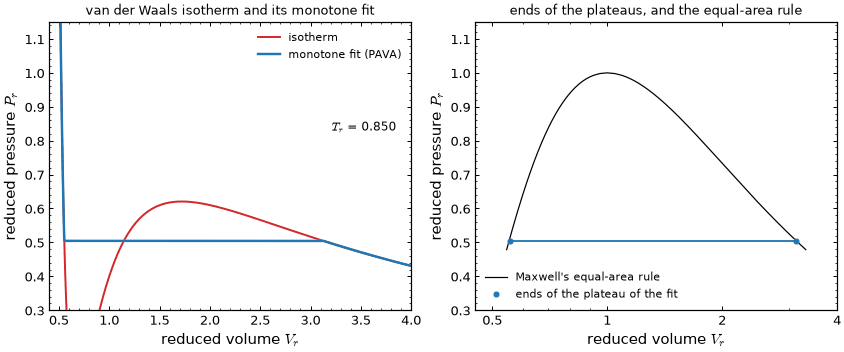

<sub>Left: a van der Waals isotherm below the critical temperature and its monotone fit by the pool-adjacent-violators algorithm, which replaces the loop by a plateau. Right: the ends of the plateaus at 30 temperatures, on the coexistence curve computed independently from Maxwell's equal-area rule; the plateau pressures agree with it to 2 × 10⁻⁶ (Lecture 3). (<code>scripts/make_readme_animation.py</code>)</sub>

</div>

A model fitted to process or materials data is asked to do more than reproduce the data. Its
predictions should close the atom balances, a fitted isotherm should not let the pressure rise
with the volume, a calibration should survive a change of path length in the probe, and a
prediction should come with an interval and with a warning when the input is unlike anything in
the training set. This volume teaches the methods that provide these properties: least squares
with exact linear constraints and data reconciliation; monotone, convex and robust regression;
the chemometric methods for spectra and correlated sensors; clustering; trees and their
ensembles; and conformal prediction intervals with out-of-distribution checks. It has **18
lectures in six parts**, each an executed notebook with **two figures and three exercises**,
**worked solutions** in [`solutions/`](solutions), a small tested Python package
(**`engml_2_applied`**) whose core needs NumPy alone, and a list of
**[suggested references](docs/references.md)**. It follows
[Volume I: Foundations](https://github.com/ktwyw/engml-1-foundations) and can be read without it by
a reader who knows NumPy and least squares.

> **Start in 60 seconds:** open [Lecture 0](notebooks/part1_conservation/00_elemental_mass_and_charge_conservation_matrices.ipynb) here on GitHub (the notebooks are stored with
> their outputs): the atom balances of a methanol reactor as one matrix equation, the reactions as
> its null space, and what a noisy analysis does to the balances.

> **Status:** version 1.0.0. All 18 lectures are written, each with executed worked solutions.
> This is the second of three volumes; see the [roadmap](#roadmap).

## Why this book?

- **What is known is imposed, not learned.** A balance is an equality constraint and holds to
  rounding error; a monotone relation is fitted by a method that cannot produce anything else.
- **No black boxes.** Every method (the KKT solve, reconciliation, the pool-adjacent-violators
  algorithm, I-splines, Huber and quantile regression, PCA, PLS, K-means, spectral clustering,
  Gaussian mixtures, trees, forests, boosting, conformal intervals) is written out in a few dozen
  lines of NumPy in the `engml_2_applied` package, and each lecture repeats by hand the calculation
  of the function it uses and prints the difference.
- **Every method is checked.** Each lecture compares the library with a calculation done by hand in
  the notebook, and with an exact result where one exists: an identity, a closed form, a
  thermodynamic construction. The differences are printed.
- **Pictures beside the theory.** Two figures in every lecture, computed in the notebook.
- **Honest about what the results show.** All data sets are synthetic and labelled so. Where a
  method does worse than a simpler one (the I-spline of Lecture 4 has the largest error of the
  three fits; a constraint moves one yield away from its true value; a forest stops improving
  after ten trees), the lecture says so.

## What the checks show

<p align="center">
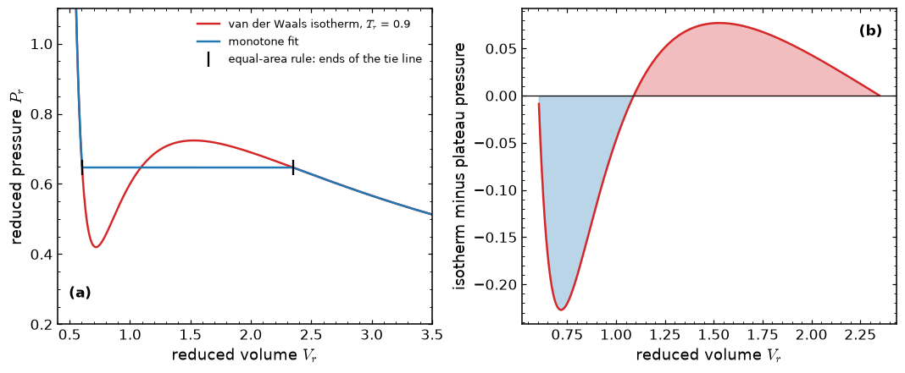
</p>

The monotone fit of a van der Waals isotherm at $T_r = 0.9$ by
`engml_2_applied.linear_physics.pava_monotone_regression`, and the tie line of Maxwell's equal-area
rule computed independently by bisection ([Lecture 3](notebooks/part2_shape/03_thermodynamic_stability_and_pava_isotonic_regression.ipynb)). The table collects checks of this
kind from the lectures, and, in its last rows, how the methods compare on data kept out of the fits.

| Check | Computed | Reference | Agreement |
|---|---|---|---|
| Element balances of compositions built from reaction extents | $\mathbf{C}\mathbf{w} - \mathbf{d}$ | zero | rounding error |
| Least squares with three element balances as constraints | `equality_constrained_lstsq` | the balances | 10⁻¹⁵ mol; condition number 153, against 4 × 10¹² for a penalty that closes them to 10⁻¹² |
| Reconciliation of a splitter | `crowe_data_reconciliation` | adjustments in the ratio of the variances, 1 : 1 : 4 | exact |
| Reconciliation of a reactor, separator and recycle | balances of the three units | zero | 10⁻¹⁴ kg/h |
| Monotone fit | mean of the fit | mean of the data | 10⁻¹² (relative) |
| Plateau of the monotone fit of a van der Waals isotherm, $T_r = 0.9$ | $P_r$ = 0.64700, from $V_r$ = 0.605 to 2.348 | Maxwell's rule: 0.64700, from 0.603 to 2.349 | the spacing of the grid, 0.0025 |
| The same at 30 temperatures from $T_r$ = 0.85 to 0.995 | plateau pressure | Maxwell's rule | 2 × 10⁻⁶ |
| I-spline basis | derivative by finite differences | the M-spline basis | 2 × 10⁻¹¹ |
| Standard normal variate | ten spectra that differ by up to 5.2 AU in scale and offset | one spectrum | 2 × 10⁻¹⁵ |
| Residual of a truncated principal component model | sum of squares | $(N-1)$ times the discarded eigenvalues | rounding error |
| PLS score vectors | off-diagonal part of $\mathbf{T}^\top\mathbf{T}$ | zero | 10⁻¹⁴ |
| Mean of Hotelling's $T^2$ over the training data | 1.97500000 | $k(N-1)/N$ | all printed digits |
| K-means | within-cluster plus between-cluster sum of squares | total sum of squares | all printed digits |
| Normalized Laplacian of three rings | three eigenvalues below 3 × 10⁻⁵, the fourth 0.034 | as many zero eigenvalues as disconnected pieces | – |
| Gaussian mixture at the midpoint of two symmetric clusters | responsibilities [0.5, 0.5]; entropy 0.693147 | one half each; ln 2 | all printed digits |
| Split search of a regression tree | running sums, all $N-1$ thresholds | direct calculation | 10⁻¹⁴ |
| Variance of an average of correlated estimates | $\rho\sigma^2 + (1-\rho)\sigma^2/B$ | the full covariance matrix | all printed digits |
| Mean of the squared Mahalanobis distance over the training data | 2.96250000 | $d(N-1)/N$ | all printed digits |
| Conformal intervals under skewed noise, 300 calibration points | coverage of 1000 test points: 80.6, 92.9, 97.1, 98.8 % | targets of 80, 90, 95, 98 % | at or above the target, by up to 2.9 points |
| Robust regression, three spikes of +25 | error of the parameters: Huber 0.093 | least squares 1.681 | 94 % smaller |
| Calibration of synthetic spectra with random path lengths | PLS after SNV: 0.0043 mol/L | PLS on raw spectra: 0.095 mol/L | 20 times smaller |
| 120 channels, 35 samples, 40 test samples | PLS, 3 latent variables: 0.0145 mol/L | minimum-norm least squares: 0.050 mol/L | 3.4 times smaller |
| Forest of 25 trees, 120 test points | mean squared error 0.85 | one tree: 1.63 | 48 % smaller |
| Capstone: three predicted carbon fractions | sum after projection | 1 | rounding error (0.043 before); mean squared error 24 % smaller; 90 % intervals cover 93.8, 91.2 and 92.5 % |

The 158 checks of the whole package, with their values, are listed in [docs/validation.md](docs/validation.md).

## Gallery

Each lecture has two figures; one from each is shown here.

| | |
|---|---|
| 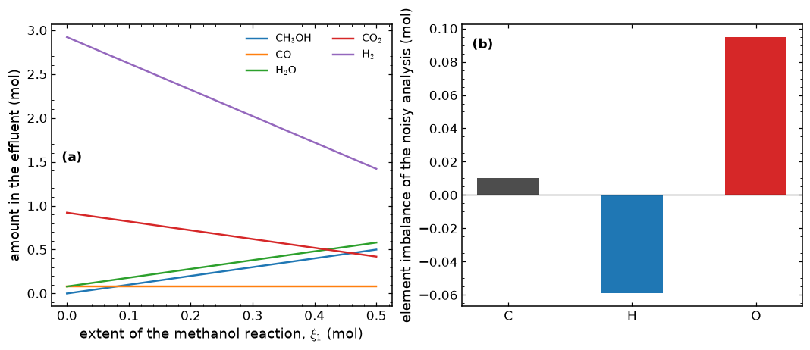<br>Compositions that conserve every element, and a noisy analysis that does not (synthetic data) ([Lecture 0](notebooks/part1_conservation/00_elemental_mass_and_charge_conservation_matrices.ipynb)) | 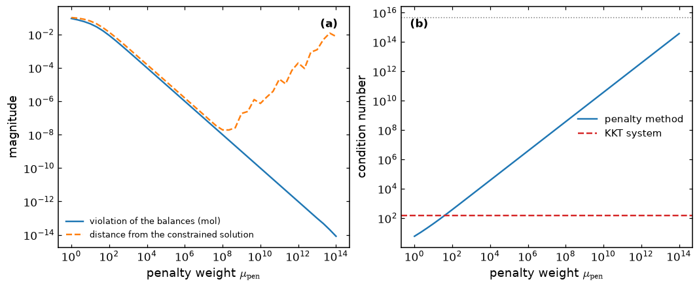<br>A penalty in place of an exact constraint: the balance closes while the conditioning is lost ([Lecture 1](notebooks/part1_conservation/01_kkt_equality_constrained_regression.ipynb)) |
| 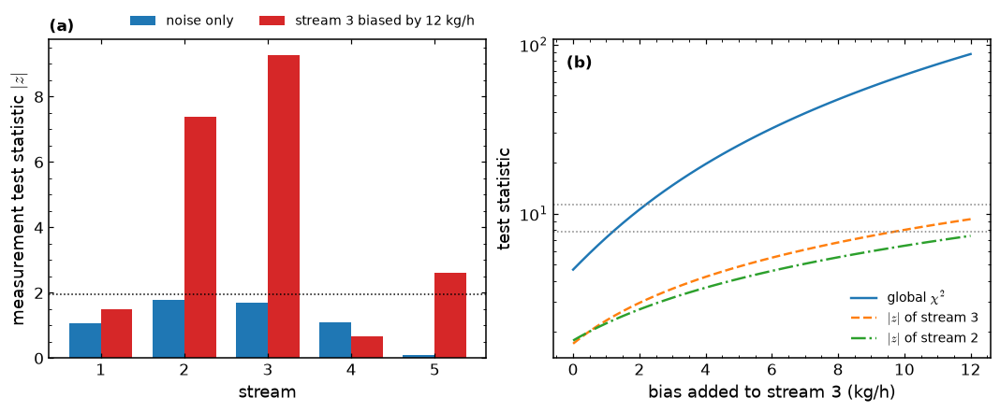<br>A biased flow meter: the measurement test and the global $\chi^2$ statistic (synthetic data) ([Lecture 2](notebooks/part1_conservation/02_process_data_reconciliation_and_gross_error_detection.ipynb)) | 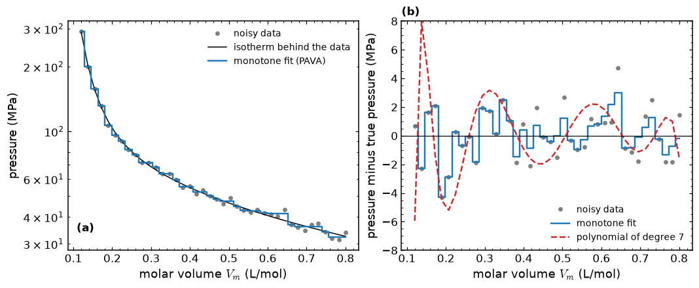<br>A noisy synthetic isotherm, its monotone fit and a polynomial of degree 7 ([Lecture 3](notebooks/part2_shape/03_thermodynamic_stability_and_pava_isotonic_regression.ipynb)) |
| 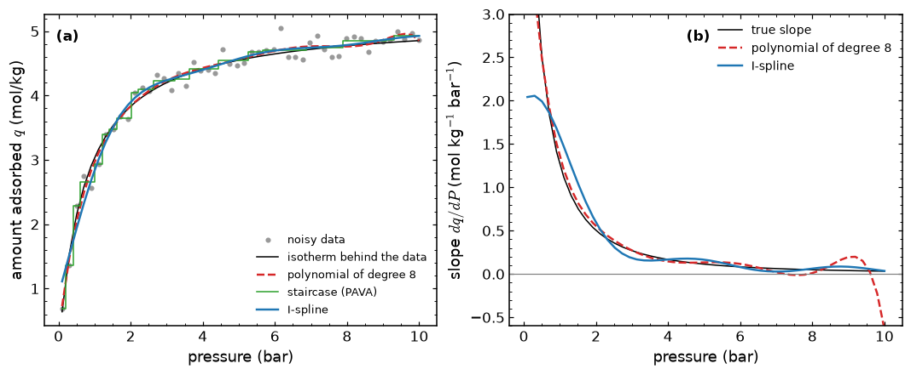<br>A staircase, an I-spline and a polynomial fitted to a synthetic adsorption isotherm, and their slopes ([Lecture 4](notebooks/part2_shape/04_monotone_splines_and_convex_free_energy_potentials.ipynb)) | 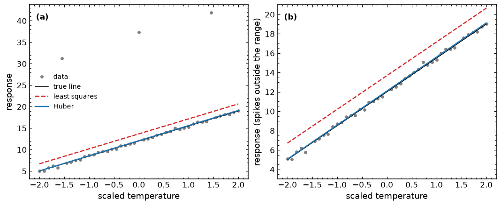<br>Three spikes move the least-squares line; the Huber line stays on the true one (synthetic data) ([Lecture 5](notebooks/part2_shape/05_outlier_robust_regression_huber_irls_and_quantile_loss.ipynb)) |
| 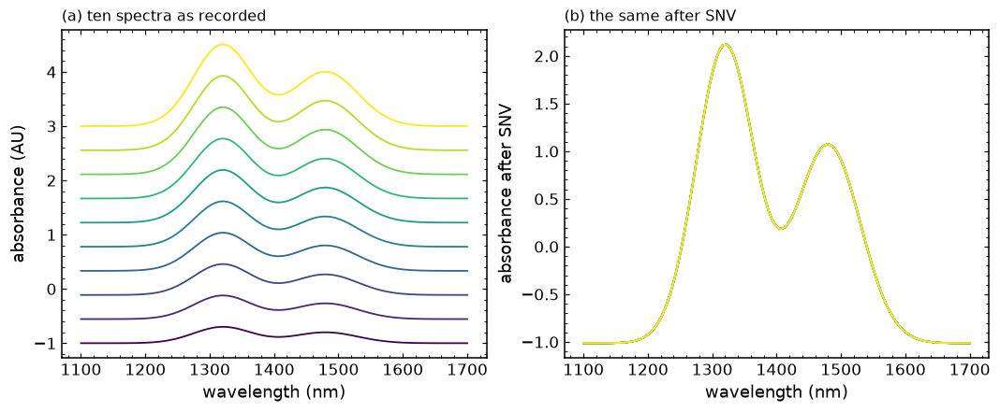<br>Ten synthetic spectra with different path lengths and offsets, before and after SNV ([Lecture 6](notebooks/part3_chemometrics/06_beer_lambert_spectroscopy_and_spectral_preprocessing.ipynb)) | 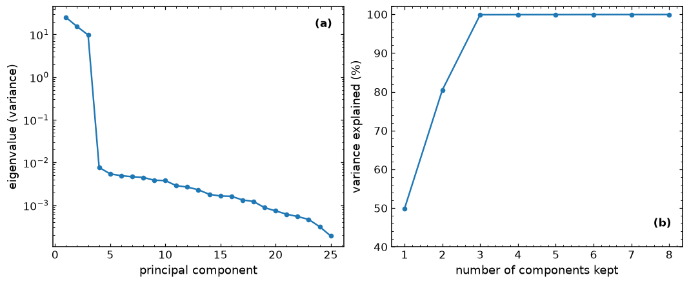<br>Eigenvalues of spectra generated by three species: three components carry the signal ([Lecture 7](notebooks/part3_chemometrics/07_svd_principal_component_analysis_and_pcr.ipynb)) |
| 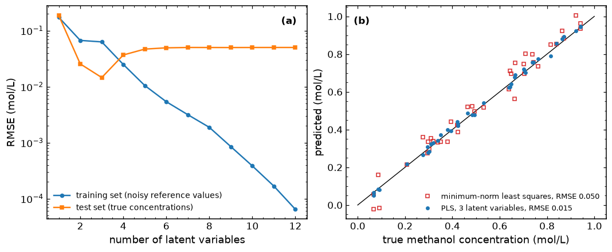<br>Partial least squares: the error against the number of latent variables, and predictions for new samples ([Lecture 8](notebooks/part3_chemometrics/08_partial_least_squares_nipals_for_soft_sensors.ipynb)) | 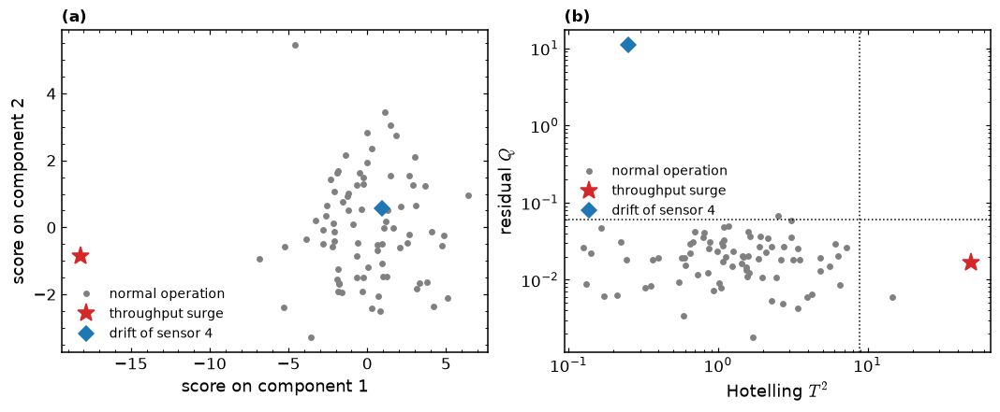<br>A throughput surge and a drifting sensor in the score plane and in the $T^2$–$Q$ plane (synthetic data) ([Lecture 9](notebooks/part3_chemometrics/09_multivariate_process_monitoring_hotelling_t2_and_q.ipynb)) |
| 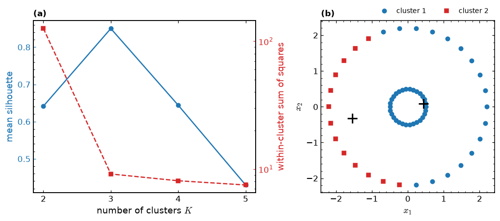<br>Choosing the number of clusters, and two rings that K-means cannot separate ([Lecture 10](notebooks/part4_clustering/10_unsupervised_phase_clustering_kmeans_and_voronoi.ipynb)) | 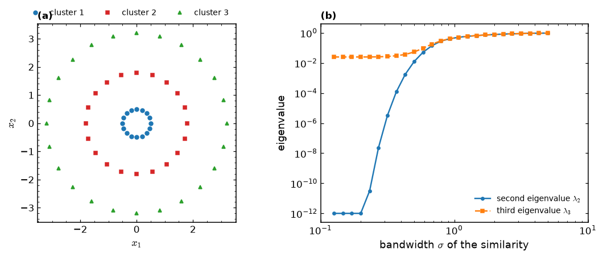<br>Three concentric rings separated by spectral clustering, and the role of the bandwidth ([Lecture 11](notebooks/part4_clustering/11_normalized_laplacian_spectral_clustering_manifolds.ipynb)) |
| 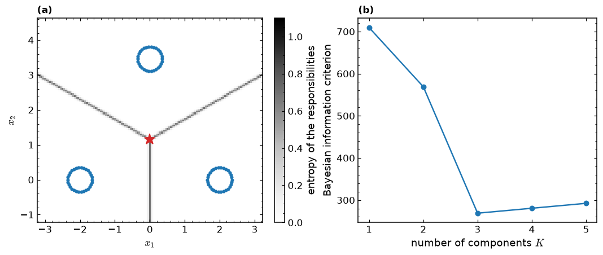<br>The entropy of the responsibilities marks the boundaries between three clusters; the information criterion selects three ([Lecture 12](notebooks/part4_clustering/12_gaussian_mixture_models_and_gibbs_phase_rule.ipynb)) | 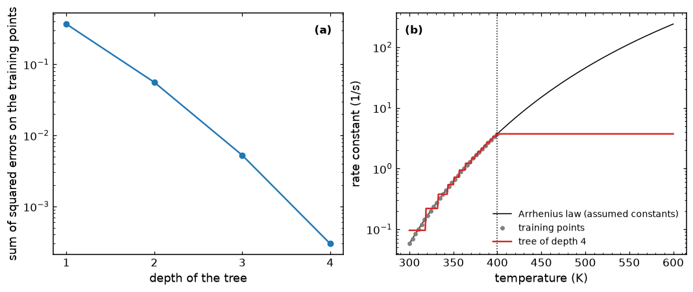<br>A tree trained on an Arrhenius rate constant returns a constant beyond its training range ([Lecture 13](notebooks/part5_ensembles/13_decision_trees_cart_and_prefix_sum_splitting.ipynb)) |
| 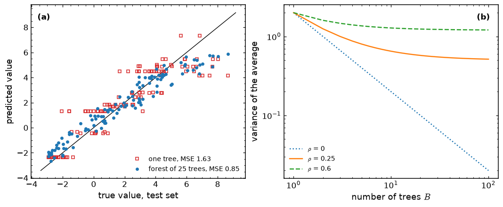<br>One tree against a forest of 25, and the variance of an average of correlated estimates ([Lecture 14](notebooks/part5_ensembles/14_random_forests_bagging_and_feature_importance.ipynb)) | 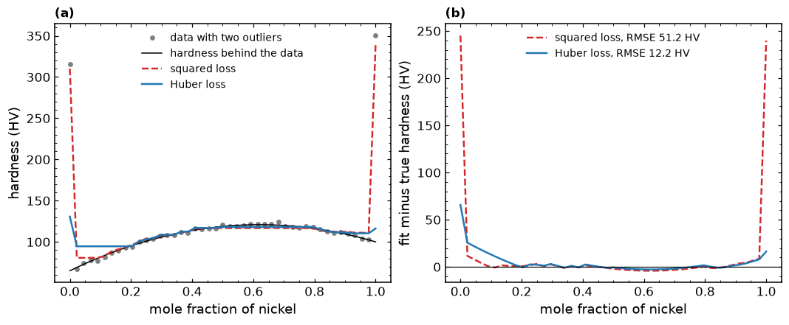<br>Boosting with the squared loss follows two outliers; the Huber loss limits their influence ([Lecture 15](notebooks/part5_ensembles/15_functional_gradient_boosting_and_huber_clipping.ipynb)) |
| 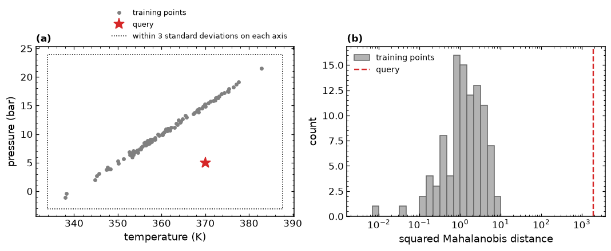<br>A query within the range of each variable and far from the data: the Mahalanobis distance ([Lecture 16](notebooks/part6_guardrails/16_split_conformal_prediction_and_mahalanobis_ood.ipynb)) | 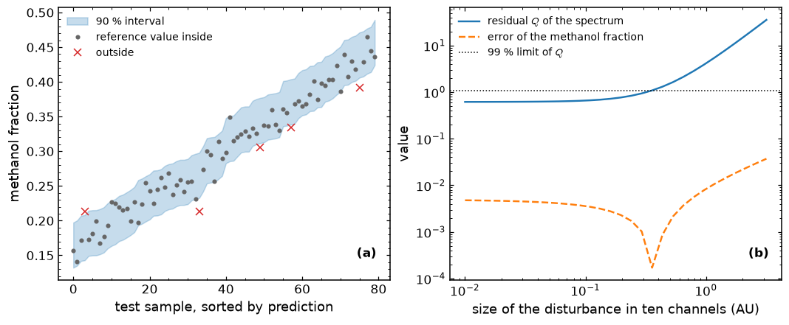<br>The capstone soft sensor: conformal intervals, and a residual limit that withholds a prediction ([Lecture 17](notebooks/part6_guardrails/17_capstone_industrial_soft_sensor_and_reconciliation.ipynb)) |

## Installation

```bash
git clone https://github.com/ktwyw/engml-2-applied.git
cd engml-2-applied
pip install -e ".[book]"
jupyter lab
```

The distribution is called `engml-2-applied` and is imported as `engml_2_applied`; the packages of
Volumes I and III (`engml_1_foundations`, `engml_3_frontier`) can be installed beside it. The
notebooks also run without installation: each one adds the repository root to the path if the
package is not installed, and installs it from GitHub when it is opened on Google Colab. The package
needs NumPy alone; Matplotlib is used for the figures.

## Quick start

```python
import numpy as np
from engml_2_applied import linear_physics, uncertainty

# least squares with exact element balances (Lecture 1): CO2 + 3 H2 -> CH3OH + H2O, CO2 + H2 -> CO + H2O
C = np.array([[1, 1, 0, 1, 0],        # carbon in   CH3OH, CO, H2O, CO2, H2
              [4, 0, 2, 0, 2],        # hydrogen
              [1, 1, 1, 2, 0]])       # oxygen
d = C @ np.array([0.0, 0.0, 0.0, 1.0, 3.0])                     # feed: 1 mol CO2 and 3 mol H2
w_meas = np.array([0.62, 0.09, 0.69, 0.31, 1.13])               # an analysis with errors (mol), assumed
C @ w_meas - d                                                  # [0.02, 0.12, 0.02]: the balances do not close
w = linear_physics.equality_constrained_lstsq(np.eye(5), w_meas, C, d)["w"]
np.abs(C @ w - d).max()                                         # 2e-16

# data reconciliation of a splitter, stream 1 = stream 2 + stream 3 (Lecture 2)
rec = linear_physics.crowe_data_reconciliation(np.array([100.0, 61.0, 36.0]), np.array([1.0, 1.0, 2.0]),
                                               np.array([[1.0, -1.0, -1.0]]), np.array([0.0]))
rec["y_reconciled"]                                             # [99.5, 61.5, 38.0]

# monotone regression of a van der Waals isotherm at T_r = 0.9 (Lecture 3)
V = np.linspace(0.45, 5.0, 1821)
P = 8 * 0.9 / (3 * V - 1) - 3 / V**2
linear_physics.pava_monotone_regression(P, increasing=False)[V.searchsorted(1.0)]   # 0.6470, the saturation pressure

# a conformal interval from 300 calibration residuals with skewed noise (Lecture 16)
rng = np.random.default_rng(0)
y_cal_pred = rng.uniform(0, 5, 300)
y_cal = y_cal_pred + rng.exponential(0.45, 300) - 0.45
uncertainty.split_conformal_interval(y_cal, y_cal_pred, np.array([2.0]), alpha=0.10)["q_hat"]   # 0.616: the interval is 2.0 ± 0.616
```

## What's inside

**Part I. Conservation as a constraint**

| Lecture | Topics | Checked against |
|---|---|---|
| [0. Atom, mass and charge balances as linear constraints](notebooks/part1_conservation/00_elemental_mass_and_charge_conservation_matrices.ipynb) | the matrix of atom counts and charges; total mass as a dependent row; the null space and extents of reaction; projection of a noisy analysis onto the balances | the reactions written by hand; balances closed to rounding error |
| [1. Least squares with exact constraints: the KKT system](notebooks/part1_conservation/01_kkt_equality_constrained_regression.ipynb) | the KKT system; the correction that turns the unconstrained solution into the constrained one; the covariance of the constrained estimate; penalties and conditioning | the block system solved by hand; repeated synthetic experiments |
| [2. Data reconciliation and the detection of gross errors](notebooks/part1_conservation/02_process_data_reconciliation_and_gross_error_detection.ipynb) | weighted reconciliation; a splitter by hand; a reactor, separator and recycle; the global $\chi^2$ test and the measurement test | adjustments in the ratio of the variances; unit balances closed to rounding error |

**Part II. Monotone, convex and robust fits**

| Lecture | Topics | Checked against |
|---|---|---|
| [3. Monotone fits and the pool-adjacent-violators algorithm](notebooks/part2_shape/03_thermodynamic_stability_and_pava_isotonic_regression.ipynb) | convexity of the Helmholtz energy and a monotone pressure; the pool-adjacent-violators algorithm by hand and with a stack; comparison with polynomials; the van der Waals loop | the mean of the data; Maxwell's equal-area rule |
| [4. Smooth monotone fits with I-splines](notebooks/part2_shape/04_monotone_splines_and_convex_free_energy_potentials.ipynb) | M-splines and I-splines; projected coordinate descent with non-negative weights; value and slope against the staircase and a polynomial; a convex free energy | the derivative of each I-spline by finite differences |
| [5. Robust regression: the Huber loss and quantile regression](notebooks/part2_shape/05_outlier_robust_regression_huber_irls_and_quantile_loss.ipynb) | the Huber loss and the weights of IRLS; median and quantile regression with the pinball loss; the choice of the threshold | the parameters that generated the data; the weights $\delta/|r_i|$ |

**Part III. Chemometrics and process monitoring**

| Lecture | Topics | Checked against |
|---|---|---|
| [6. Spectra, the Beer–Lambert law and preprocessing](notebooks/part3_chemometrics/06_beer_lambert_spectroscopy_and_spectral_preprocessing.ipynb) | the Beer–Lambert law for a mixture; the standard normal variate; the first derivative and its noise; the effect on a PLS calibration | exact invariance to a scale factor and an offset |
| [7. Principal component analysis and regression on components](notebooks/part3_chemometrics/07_svd_principal_component_analysis_and_pcr.ipynb) | principal components by SVD; orthogonality of loadings and scores; the residual of a truncated model; regression on components and the case in which it fails | the sum of the discarded eigenvalues; the number of species that generated the spectra |
| [8. Partial least squares for soft sensors](notebooks/part3_chemometrics/08_partial_least_squares_nipals_for_soft_sensors.ipynb) | the NIPALS algorithm; orthogonal scores; PLS against minimum-norm least squares with more channels than samples; the number of latent variables | the closed formula for the regression vector; test samples of known concentration |
| [9. Process monitoring with Hotelling's T² and the Q residual](notebooks/part3_chemometrics/09_multivariate_process_monitoring_hotelling_t2_and_q.ipynb) | the model plane and the residual; Hotelling's $T^2$ and $Q$; a throughput surge against a drifting sensor; contributions to $Q$ | the mean of $T^2$, $k(N-1)/N$; identities of the two projectors |

**Part IV. Clustering and phases**

| Lecture | Topics | Checked against |
|---|---|---|
| [10. Clustering with K-means, and where it fails](notebooks/part4_clustering/10_unsupervised_phase_clustering_kmeans_and_voronoi.ipynb) | k-means++ seeding and the two alternating steps; the silhouette; concentric rings, where the method fails | total = within + between sums of squares; the groups that generated the points |
| [11. Spectral clustering with the normalized Laplacian](notebooks/part4_clustering/11_normalized_laplacian_spectral_clustering_manifolds.ipynb) | the graph of Gaussian similarities; the normalized Laplacian; clustering its eigenvectors; the bandwidth and the gap between eigenvalues | the number of zero eigenvalues; rings of known membership |
| [12. Gaussian mixtures and the Gibbs phase rule](notebooks/part4_clustering/12_gaussian_mixture_models_and_gibbs_phase_rule.ipynb) | the EM algorithm; responsibilities; their entropy at boundaries; the Bayesian information criterion and the Gibbs phase rule | responsibilities of one half at a midpoint; $\ln 2$ and $\ln 3$ |

**Part V. Trees and ensembles**

| Lecture | Topics | Checked against |
|---|---|---|
| [13. Regression trees and splitting by running sums](notebooks/part5_ensembles/13_decision_trees_cart_and_prefix_sum_splitting.ipynb) | the best split from running sums; trees of increasing depth; conservation of the mean; constant predictions outside the training range | every candidate split computed directly; the threshold that generated the data |
| [14. Bagging, random forests and permutation importance](notebooks/part5_ensembles/14_random_forests_bagging_and_feature_importance.ipynb) | bootstrap samples and averaging; the variance of an average of correlated estimates; permutation importance; the number of trees | the full covariance matrix; the variables that enter the synthetic response |
| [15. Gradient boosting and the Huber loss](notebooks/part5_ensembles/15_functional_gradient_boosting_and_huber_clipping.ipynb) | fitting residuals in stages; the learning rate; clipped residuals of the Huber loss; data with gross outliers | the curve that generated the data |

**Part VI. Prediction intervals and a capstone**

| Lecture | Topics | Checked against |
|---|---|---|
| [16. Conformal prediction intervals and out-of-distribution alarms](notebooks/part6_guardrails/16_split_conformal_prediction_and_mahalanobis_ood.ipynb) | split conformal intervals and their finite-sample quantile; coverage under skewed noise; the Mahalanobis distance; a query inside every single range and outside the data | coverage on 1000 test points; the mean of $D_M^2$, $d(N-1)/N$ |
| [17. Capstone: a soft sensor with a carbon balance, intervals and an alarm](notebooks/part6_guardrails/17_capstone_industrial_soft_sensor_and_reconciliation.ipynb) | SNV, three PLS models, projection onto the carbon balance, weighted reconciliation, conformal intervals, and a limit on $Q$ that withholds a prediction | the carbon balance to rounding error; coverage on the test samples |

Each lecture has the same sections: principles and governing equations, a numerical walkthrough, a
worked case, a study of the sensitivity to the parameters, the calculation of the package repeated
by hand, and three exercises (verify a result, find how the method fails, write it
yourself) with worked solutions in [`solutions/`](solutions).

## The `engml_2_applied` package

| Module | Purpose |
|---|---|
| `linear_physics` | least squares with linear equality constraints (the KKT system); weighted data reconciliation with its $\chi^2$ and measurement statistics; monotone regression by the pool-adjacent-violators algorithm; M-spline and I-spline bases and a monotone spline fit by projected coordinate descent; Huber and quantile regression by iteratively reweighted least squares. It also holds the regression functions of Volume I (ridge, lasso, elastic net, variance inflation factors, logistic regression) |
| `dim_reduction` | the standard normal variate and the first derivative of spectra; principal components by SVD with Hotelling's $T^2$ and the residual $Q$; regression on principal components; partial least squares for one response by the NIPALS algorithm |
| `clustering_phases` | K-means with k-means++ seeding; the mean silhouette; spectral clustering with the normalized Laplacian; Gaussian mixtures with diagonal covariances by the EM algorithm |
| `trees_ensembles` | the best split of a variable from running sums; a regression tree; a random forest; permutation importance; gradient boosting with the squared loss and with the Huber loss |
| `uncertainty` | split conformal prediction intervals; the squared Mahalanobis distance of a query from a training set |
| `plotting` | the plotting style of the figures (Matplotlib) |
| `constants`, `foundations`, `descriptors` | constants, a table of 16 compounds, and the methods of Volume I (dimensional analysis, corresponding states, molecular graph descriptors, scalers). They are not taught in this volume and are included with their tests |
| `kernels_gp`, `bo_active`, `neural_mlp`, `pinn`, `sindy_ude` | methods of Volume III (Gaussian processes, Bayesian optimization, a small differentiable network, collocation solvers, sparse identification of rate laws), not used in this volume and included with their tests; they are taught in Volume III, whose package is `engml_3_frontier` |

Run the tests with `pytest -q`. They include the 158 comparisons of the package with exact
identities, limits and reference values in `scripts/validate.py`, and checks that all 36 notebooks
are stored executed and free of errors.

## Repository layout

```
engml_2_applied/               the Python package
notebooks/part1_conservation/  Lectures 0-2, executed
notebooks/part2_shape/         Lectures 3-5
notebooks/part3_chemometrics/  Lectures 6-9
notebooks/part4_clustering/    Lectures 10-12
notebooks/part5_ensembles/     Lectures 13-15
notebooks/part6_guardrails/    Lectures 16-17
solutions/                     worked solutions to the exercises, executed
tests/                         tests of the package and of the stored notebooks
docs/                          introduction, syllabus, notation, validation report and references; images
scripts/                       the plain-text sources of the notebooks and the script that builds them;
                               the validation report; the figures of this page
myst.yml                       Jupyter Book 2 configuration
```

The notebooks are built from plain-text sources: edit `scripts/lectures_*.py` or
`scripts/lecture_figures.py` and run `python scripts/build_notebooks.py`, which executes every
notebook in a fresh kernel. See [CONTRIBUTING.md](CONTRIBUTING.md).

## Suggested references

The notebooks are self-contained and do not follow any book. For further study, see the list in
[docs/references.md](docs/references.md), which starts with T. Hastie, R. Tibshirani and J. Friedman,
*The Elements of Statistical Learning*, 2nd ed. (Springer, 2009), which the authors make freely
available, and S. Narasimhan and C. Jordache, *Data Reconciliation and Gross Error Detection*
(Gulf Professional Publishing, 1999).

## Companion books

- [engml-1-foundations](https://github.com/ktwyw/engml-1-foundations) and
  [engml-3-frontier](https://github.com/ktwyw/engml-3-frontier): Volumes I and III of this series.
- [engtransport](https://github.com/ktwyw/engtransport): heat and mass transfer through worked problems.
- [onsager-variational-methods](https://github.com/ktwyw/onsager-variational-methods): variational
  methods in soft matter.
- [error-analysis](https://github.com/ktwyw/error-analysis): evaluating, propagating and reporting
  uncertainty.
- [from-formulas-to-programs](https://github.com/ktwyw/from-formulas-to-programs): a first course in
  programming for engineers.

Also by the author: [engmath](https://github.com/ktwyw/engmath), [engstat](https://github.com/ktwyw/engstat),
[engnumeric](https://github.com/ktwyw/engnumeric), [engregress](https://github.com/ktwyw/engregress),
[engthermo](https://github.com/ktwyw/engthermo), [engbalance](https://github.com/ktwyw/engbalance),
[engreact](https://github.com/ktwyw/engreact), [engsep](https://github.com/ktwyw/engsep),
[fluidmech](https://github.com/ktwyw/fluidmech), [engrheo](https://github.com/ktwyw/engrheo),
[engcolloid](https://github.com/ktwyw/engcolloid), [polyphys](https://github.com/ktwyw/polyphys),
[engsim](https://github.com/ktwyw/engsim), [engmolines](https://github.com/ktwyw/engmolines),
[engstoch](https://github.com/ktwyw/engstoch), [englincontrol](https://github.com/ktwyw/englincontrol)
and [engdiscrete](https://github.com/ktwyw/engdiscrete).

## Scope and limitations

- **All data sets are synthetic.** Flows, analyses, isotherms, spectra, sensor readings, hardness
  curves and rate constants are generated in the notebooks from stated formulas, random-number seeds
  and assumed constants. The names (a methanol reactor, near-infrared spectra, a catalyst light-off
  curve, the hardness of a binary alloy) describe the form of the data and not a measurement. The
  results show how the methods behave; they are not estimates of the accuracy to be expected on a
  plant.
- **Most comparisons are single runs** with one seed. Differences of a few per cent between methods
  (the test error of a forest of 20 against 35 trees, the coverage of an interval) are within the
  scatter between runs, and the lectures say where this matters.
- **Lecture 1.** An exact constraint reduces the error of the vector of estimates as a whole. It
  does not reduce the error of every component: in the worked case one of five yields moves away
  from its true value.
- **Lecture 2.** A gross error in one flow meter also raises the test statistic of a meter that
  shares a balance with it. The $\chi^2$ limits assume Gaussian noise of known variance, and the
  network is at steady state.
- **Lecture 3.** The monotone fit is a staircase. Its plateau coincides with Maxwell's construction
  for a noise-free isotherm on a uniform grid in volume; it is not a method for computing phase
  equilibria from data.
- **Lecture 4.** With the nine knots of the worked case the I-spline has a larger error than the
  staircase and than an unconstrained polynomial. What it provides is a continuous, non-negative
  slope; its accuracy depends on the number of knots.
- **Lectures 6 to 8.** The synthetic spectra are sums of Gaussian bands with a multiplicative factor,
  an offset and white noise. Measured spectra also have curved baselines, shifts of the bands and
  nonlinear responses, which are outside the scope. In one exercise of Lecture 8, PLS is no better
  than regression on principal components until three components are used.
- **Lecture 9.** The limits on $T^2$ and $Q$ are empirical 99th percentiles of 80 training points.
- **Lectures 10 to 12.** The clusters are synthetic clouds and rings that stand for phases or
  regimes. Spectral clustering needs a bandwidth, and the lecture shows the range over which it
  works. The Gaussian mixture has diagonal covariances.
- **Lectures 13 to 15.** Trees, forests and boosted trees predict a constant outside the range of
  their training data. With the Huber loss the two outliers of Lecture 15 still leave a trace in the
  fit.
- **Lecture 16.** The coverage of a conformal interval is guaranteed on average over calibration
  sets and for test data that are exchangeable with them. The variant with intervals of variable
  width, in Exercise 3, covers 87.2 % in its single run against a target of 90 %.
- **The solvers** are written to be read. They use dense linear algebra and plain loops, and are
  meant for problems with tens to thousands of rows, not as replacements for production libraries.

## Roadmap

Version 1.0.0 is the complete second volume.
[Volume I](https://github.com/ktwyw/engml-1-foundations) covers scientific Python, dimensional
analysis, corresponding states, molecular graph descriptors and regularized regression.
[Volume III](https://github.com/ktwyw/engml-3-frontier) covers Gaussian processes, Bayesian optimization, a differentiable network, physics-informed collocation, the identification of rate laws and hybrid reactor models. Planned for this volume: a measured set of near-infrared spectra and a measured set of plant
flows with cited sources, and repetitions over seeds for the comparisons that are now single runs.
Corrections and suggestions are welcome through the
[issue tracker](https://github.com/ktwyw/engml-2-applied/issues).

## Author

**Yanwei Wang**, Department of Chemical and Materials Engineering, School of Engineering, Nazarbayev
University, Astana, Kazakhstan · yanwei.wang@nu.edu.kz ·
ORCID [0000-0002-8488-9833](https://orcid.org/0000-0002-8488-9833)

## Citing

Please cite the material using the metadata in [`CITATION.cff`](CITATION.cff).

## License

Code (`engml_2_applied/`, `tests/`, `scripts/` and the code cells of the notebooks):
[MIT](LICENSE). Text, figures and notebook outputs: [CC BY 4.0](DATA_LICENSE.md).
